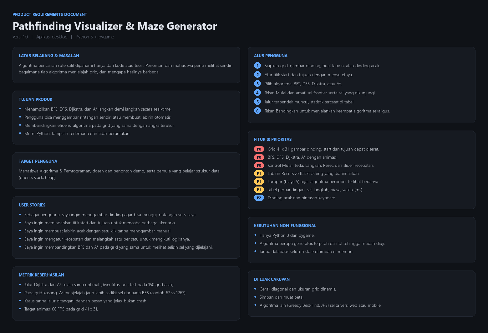
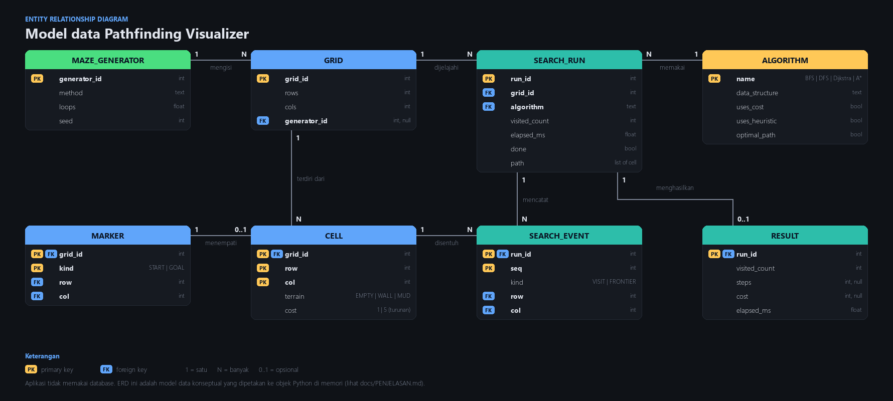
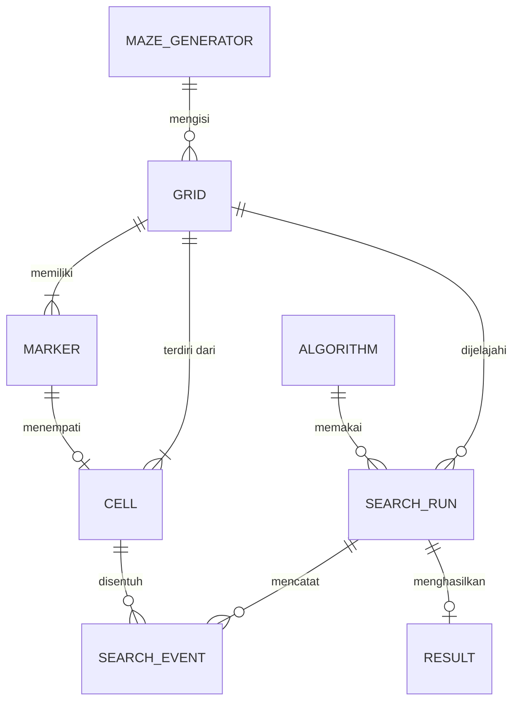
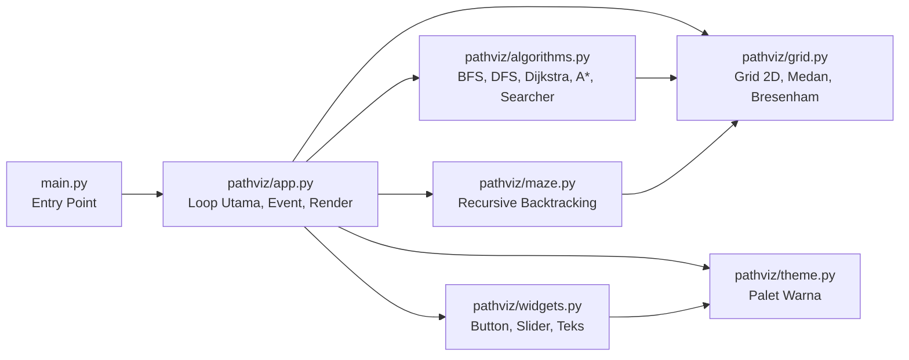

# Dokumentasi Proyek: Pathfinding Visualizer & Maze Generator

Dokumen ini berisi penjelasan lengkap mengenai arsitektur, cara kerja algoritma, struktur data, **Product Requirements Document (PRD)**, serta **Entity Relationship Diagram (ERD)** dari aplikasi **Pathfinding Visualizer & Maze Generator**.

---

## 1. Product Requirements Document (PRD)

### 1.1 Latar Belakang & Masalah
Algoritma pencarian rute (*pathfinding*) dan struktur data seperti *Queue*, *Stack*, serta *Priority Queue (Heap)* sering kali terasa abstrak jika hanya dipelajari melalui kode atau teori di kelas. Mahasiswa dan penonton demo membutuhkan representasi visual langkah demi langkah (*real-time*) untuk memahami:
- Mengapa **BFS** menyebar ke segala arah seperti gelombang air.
- Mengapa **DFS** menelusuri satu lorong sampai mentok baru berbalik (*backtrack*) dan menghasilkan rute yang berliku.
- Bagaimana **Dijkstra** memperhitungkan bobot medan (seperti lumpur) untuk mencari rute termurah.
- Bagaimana **A\*** memanfaatkan fungsi heuristik *Manhattan Distance* untuk langsung mengarah ke titik tujuan tanpa membuang waktu memeriksa sel yang berlawanan arah.

### 1.2 Tujuan Produk
1. Memvisualisasikan proses *frontier* (antrean kandidat) dan *visited* (sel yang telah dievaluasi) pada algoritma **BFS**, **DFS**, **Dijkstra**, dan **A\*** secara *real-time*.
2. Menyediakan kanvas interaktif tempat pengguna bisa menggambar dinding, menambahkan medan berlumpur (berbobot 5), atau menggeser titik awal (*Start*) dan tujuan (*Goal*).
3. Menyediakan generator labirin otomatis menggunakan algoritma **Recursive Backtracking** yang proses penggaliannya juga dianimasikan.
4. Menyajikan tabel perbandingan kuantitatif (**Sel dikunjungi**, **Langkah**, **Biaya**, dan **Waktu eksekusi dalam ms**) agar perbedaan efisiensi antar algoritma terlihat jelas dalam satu klik.

### 1.3 Fitur & Prioritas

| Prioritas | Fitur | Deskripsi |
| :---: | :--- | :--- |
| **P0** | Kanvas Grid Interaktif (`41 × 31`) | Menggambar/menghapus dinding, menggeser titik *Start* dan *Goal* dengan *drag-and-drop* halus (interpolasi garis Bresenham). |
| **P0** | 4 Algoritma Pathfinding | Implementasi murni Python untuk BFS, DFS, Dijkstra, dan A\* berbasis generator (`yield`). |
| **P0** | Kontrol Eksekusi & Kecepatan | Tombol Mulai/Jeda/Ulangi, maju per satu langkah (*Step*), Reset, dan *slider* kecepatan (`3` hingga `6300+` sel/detik). |
| **P1** | Generator Labirin Otomatis | Pembuatan labirin dengan *Iterative Recursive Backtracking* + pembukaan sebagian dinding (*loops* 8%) agar tersedia lebih dari satu alternatif rute. |
| **P1** | Medan Berbobot (Lumpur) | Sel lumpur memiliki biaya langkah `5` (sel normal `1`) untuk mendemonstrasikan keunggulan Dijkstra & A\* dibanding BFS. |
| **P1** | Tabel Perbandingan Instan | Tombol **Bandingkan** menjalankan keempat algoritma di latar belakang dan menyorot algoritma paling efisien (jumlah sel terkecil di antara rute dengan biaya paling optimal). |
| **P2** | Generator Dinding Acak & Pintasan | Tombol **Dinding Acak** (kerapatan 28%) dan pintasan *keyboard* (`Spasi`, `S`, `R`, `C`, `M`, `1`–`4`). |

---

## 2. Entity Relationship Diagram (ERD) & Pemetaan Data

Aplikasi ini berjalan sepenuhnya di memori (*in-memory*) tanpa sistem manajemen basis data eksternal. ERD di bawah ini memodelkan struktur data konseptual dan relasi antar entitas di dalam program, yang kemudian dipetakan langsung ke kelas dan struktur data Python.

### 2.1 Diagram Relasi (Mermaid)

### 2.2 Pemetaan Entitas ke Kode Python

| Entitas pada ERD | Representasi di Kode Python | Lokasi File | Penjelasan Struktur Data |
| :--- | :--- | :--- | :--- |
| **`GRID`** | Kelas `Grid` | `pathviz/grid.py` | Menyimpan ukuran `rows` (`31`), `cols` (`41`), dan matriks 2D `cells: list[list[int]]`. |
| **`CELL`** | Koordinat `Node = tuple[int, int]` & nilai di `grid.cells[r][c]` | `pathviz/grid.py` | Nilai medan berupa konstanta `EMPTY (0)`, `WALL (1)`, atau `MUD (2)`. Biaya langkah dihitung oleh `grid.cost(node)` (`1` untuk kosong, `5` untuk lumpur). |
| **`MARKER`** | Atribut `App.start` dan `App.goal` | `pathviz/app.py` | Bertipe `Node = (row, col)` yang menandai posisi titik awal dan titik tujuan. |
| **`MAZE_GENERATOR`** | Fungsi generator `recursive_backtracker(grid, rng, loops)` | `pathviz/maze.py` | Memakai *explicit stack* `list[Node]` dan himpunan `seen: set[Node]` untuk menggali lorong labirin langkah demi langkah. |
| **`ALGORITHM`** | Kamus `ALGORITHMS` & `ALGORITHM_INFO` | `pathviz/algorithms.py` | Memetakan nama algoritma (`"BFS"`, `"DFS"`, `"Dijkstra"`, `"A*"`) ke fungsi generatornya. |
| **`SEARCH_RUN`** | Kelas `Searcher` | `pathviz/algorithms.py` | Membungkus generator algoritma yang sedang berjalan, menghitung sel yang dikunjungi (`visited`), durasi eksekusi (`elapsed`), dan menyimpan `path`. |
| **`SEARCH_EVENT`** | Tuple `Event = tuple[str, Node]` | `pathviz/algorithms.py` | Dihasilkan setiap kali generator melakukan `yield`, bertipe `("frontier", node)` atau `("visit", node)`. |
| **`RESULT`** | `@dataclass(frozen=True) class Result` | `pathviz/algorithms.py` | Menyimpan hasil akhir pencarian (`name`, `visited`, `steps`, `cost`, `ms`) untuk ditampilkan pada tabel perbandingan. |

---

## 3. Penjelasan Algoritma & Struktur Data

Seluruh algoritma pencarian di [`pathviz/algorithms.py`](../pathviz/algorithms.py) ditulis sebagai **fungsi generator Python**. Setiap kali sebuah sel dimasukkan ke antrean kandidat atau dievaluasi, fungsi akan melakukan `yield (jenis_event, koordinat)`, sehingga antarmuka `pygame` dapat menggambar perubahannya per *frame* tanpa memblokir *main loop* (tanpa *threading* yang rumit). Saat tujuan ditemukan, fungsi menelusuri balik peta `came_from` di dalam `_trace()` dan mengembalikan daftar koordinat rute (`return path`).

### 3.1 Breadth-First Search (BFS)
- **Struktur Data Utama:** Antrean FIFO (`collections.deque`) dan tabel pelacak induk `came_from: dict[Node, Optional[Node]]`.
- **Cara Kerja:** Mengambil sel paling depan dari antrean (`popleft()`), lalu memasukkan semua tetangga yang belum pernah terlihat ke belakang antrean (`append()`).
- **Karakteristik:** Menjelajah lapis demi lapis dengan jarak langkah yang sama dari titik awal. **Menjamin rute dengan jumlah langkah paling sedikit**, tetapi **mengabaikan biaya medan** (akan menerobos lumpur karena hanya menghitung jumlah kotak).
- **Kompleksitas:** Waktu $O(V + E)$ dan Ruang $O(V)$, dengan $V = \text{baris} \times \text{kolom}$.

### 3.2 Depth-First Search (DFS)
- **Struktur Data Utama:** Tumpukan LIFO (`list` sebagai *stack* dengan `append()` dan `pop()`).
- **Cara Kerja:** Selalu mengambil sel yang paling terakhir dimasukkan ke dalam *stack*, sehingga pencarian terus maju ke satu arah sampai menemui jalan buntu, lalu mundur (*backtrack*) ke persimpangan terakhir.
- **Karakteristik:** Sangat cepat bila kebetulan arah pertamanya menuju tujuan, tetapi **tidak menjamin rute terpendek maupun termurah**. Rute yang dihasilkan biasanya panjang dan berkelok-kelok.
- **Kompleksitas:** Waktu $O(V + E)$ dan Ruang $O(V)$.

### 3.3 Algoritma Dijkstra
- **Struktur Data Utama:** *Min-Heap / Priority Queue* (`heapq`) yang menyimpan tuple `(jarak_kumulatif, tie_breaker, node)`, tabel biaya minimum `dist: dict[Node, int]`, dan himpunan `closed: set[Node]`.
- **Cara Kerja:** Selalu mengekspansi sel di *frontier* yang memiliki total biaya perjalanan terkecil dari titik *Start* ($g(n)$). Saat melewati sel lumpur, biaya bertambah `5` (bukan `1`).
- **Karakteristik:** **Menjamin rute dengan total biaya paling murah**. Jika seluruh grid kosong (semua biaya bernilai `1`), urutan eksplorasinya identik dengan BFS. Jika ada lumpur, Dijkstra akan memilih memutar lewat jalan biasa selama biaya memutarnya lebih kecil daripada menerobos lumpur.
- **Kompleksitas:** Waktu $O((V + E) \log V)$ dan Ruang $O(V)$.

### 3.4 Algoritma A* (A-Star)
- **Struktur Data Utama:** *Min-Heap / Priority Queue* (`heapq`) dengan elemen `(f, h, tie_breaker, node)`.
- **Fungsi Evaluasi:**
  $$f(n) = g(n) + h(n)$$
  di mana:
  - $g(n)$ adalah biaya riil dari titik *Start* menuju sel $n$.
  - $h(n) = |r_n - r_{\text{goal}}| + |c_n - c_{\text{goal}}|$ adalah estimasi jarak **Manhattan** dari sel $n$ ke *Goal*.
- **Mengapa Optimal (*Admissible*):** Karena gerakan hanya 4 arah (atas, kanan, bawah, kiri) dan biaya minimum per langkah adalah `1`, jarak Manhattan tidak pernah melebihi (*overestimate*) biaya sebenarnya. Ditambah *tie-breaker* pada nilai $h(n)$ yang lebih kecil, A\* langsung melaju lurus ke arah tujuan dan hanya melebar ketika terhalang dinding atau lumpur.
- **Kompleksitas:** Waktu $O((V + E) \log V)$ (dalam praktik jauh lebih sedikit sel yang dibuka dibanding Dijkstra/BFS) dan Ruang $O(V)$.

### 3.5 Generator Labirin: Iterative Recursive Backtracking
- **Struktur Data Utama:** *Explicit Stack* (`list[Node]`) dan himpunan sel kamar yang sudah dikunjungi (`seen: set[Node]`).
- **Cara Kerja (`pathviz/maze.py`):**
  1. Seluruh grid berukuran ganjil (`31 × 41`) diisi penuh dengan dinding (`WALL`).
  2. Dimulai dari kamar `(1, 1)`, algoritma memilih secara acak tetangga berjarak 2 sel yang belum dikunjungi.
  3. Dinding pemisah di tengahnya (`gap`) dan sel tujuan (`room`) diubah menjadi ruang kosong (`EMPTY`), lalu dimasukkan ke *stack*.
  4. Jika semua arah di sekitar sel teratas *stack* sudah dikunjungi, lakukan `stack.pop()` (*backtrack*) sampai menemukan kamar yang masih punya cabang.
  5. Setelah labirin sempurna (*perfect maze*, hanya 1 rute unik) terbentuk, algoritma membuka sekitar `8%` dinding penyekat secara acak (`loops=0.08`) agar tercipta beberapa percabangan rute. Dengan demikian, perbedaan kecerdasan antara BFS, DFS, Dijkstra, dan A\* di dalam labirin dapat terlihat jelas saat didemokan.

---

## 4. Arsitektur Modul

- **[`main.py`](../main.py):** Titik masuk aplikasi (`python main.py`).
- **[`pathviz/grid.py`](../pathviz/grid.py):** Model matriks 2D, pengecekan batas dan dinding, perhitungan bobot lumpur, serta algoritma garis **Bresenham** (`line_cells`) agar saat mouse digeser cepat, goresan dinding tidak terputus-putus.
- **[`pathviz/algorithms.py`](../pathviz/algorithms.py):** Implementasi keempat algoritma pencarian rute, pembungkus `Searcher`, dan pencatat hasil `Result`.
- **[`pathviz/maze.py`](../pathviz/maze.py):** Generator labirin *Recursive Backtracking*.
- **[`pathviz/widgets.py`](../pathviz/widgets.py) & [`pathviz/theme.py`](../pathviz/theme.py):** Komponen tombol, *slider* kecepatan, fungsi interpolasi warna efek kilau sel baru (`mix`), dan palet warna gelap.
- **[`pathviz/app.py`](../pathviz/app.py):** Pengelola state aplikasi, input mouse/keyboard, animasi pencarian, dan penggambaran kanvas serta tabel perbandingan.
- **[`docs/generate_diagrams.py`](generate_diagrams.py):** Skrip murni Python (`pygame` headless) untuk menghasilkan ulang gambar [`docs/prd.png`](prd.png) dan [`docs/erd.png`](erd.png).
- **[`tests/test_pathviz.py`](../tests/test_pathviz.py):** *Unit test* otomatis yang menguji keterhubungan labirin, kevalidan langkah rute, kesamaan biaya optimal antara Dijkstra dan A\* pada 150 grid acak, serta penanganan kasus tanpa rute.
